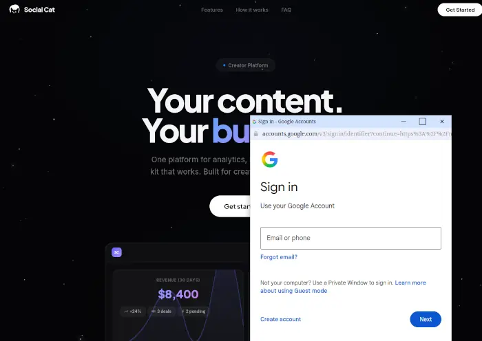

Eine kurze italienische Anfrage, kostenlose Produkte und bis zu 15.000 US-Dollar für eine lockere YouTube-Integration: Die angebliche Kooperation mit der Zahnpasta-Marke Marvis klingt fast so frisch wie Minze. Leider hinterlässt sie einen deutlich schlechteren Nachgeschmack. 🪥

Hinter dem Angebot steckt ein mehrstufiger Phishing-Versuch. Das Ziel ist nicht unsere Adresse für ein Produktpaket, sondern der Zugang zum Google-Konto.

## Erst einmal ganz unverfänglich

Die erste Nachricht kam von `toni.molinaro@libero.it` und enthielt weder einen Link noch einen Anhang:

> Ciao, ti scrivo qui, mi piace davvero molto la linea editoriale del tuo profilo. Ti andrebbe di valutare un piccolo progetto insieme?

Sinngemäß: Man finde unsere Inhalte toll und wolle über ein kleines gemeinsames Projekt sprechen. Erst nach unserer Rückfrage folgte die eigentliche Geschichte – nun von `manager@marvis.press`.

Die angebliche Vertreterin der Marke Marvis bot kostenlose Produktsets, kreative Freiheit und ein Budget zwischen **1.000 und 15.000 US-Dollar**. Bezahlt werde natürlich im Voraus. Zur Abwicklung sollten wir uns lediglich über einen persönlichen Link bei einer vermeintlichen SocialCat-Plattform registrieren und anschließend unsere Account-ID mitteilen.

Großes Budget, kaum Anforderungen und Vorkasse: Der Traum jedes Content-Creators – und genau deshalb ein guter Köder.

## Die Google-Anmeldung ist nur Kulisse

Auf der verlinkten Seite wartet eine professionell wirkende Creator-Plattform. Beim Anmelden öffnet sich scheinbar ein separates Google-Fenster:

Das Fenster gehört jedoch zur aufgerufenen Website. Die angezeigte Adresse `accounts.google.com` steckt lediglich in der nachgebauten Fensteroberfläche und ist **nicht die echte Adresszeile des Browsers**. Wer hier seine E-Mail-Adresse und sein Passwort eingibt, übergibt die Zugangsdaten den Betrügern.

Diese Masche nennt sich *Browser-in-the-Browser*: Eine Website stellt ein Anmeldefenster samt Logo, Bedienelementen und vertrauenerweckender Adresse nach. Einen sehr ähnlichen Ablauf haben wir bereits im EKiwi-Beitrag [Ich bin Künstler, vertrau mir: Der nächste fragwürdige Copyright-Hinweis](https://ekiwi.de/index.php/7134/ich-bin-kuenstler-vertrau-mir-der-naechste-fragwuerdige-copyright-hinweis/) dokumentiert.

## Die Warnzeichen

* Die erste Nachricht bleibt absichtlich vage und soll zunächst nur eine Antwort provozieren.
* Der Absender wechselt von einem italienischen Freemail-Postfach zu einer anderen Domain.
* Ein Budget von bis zu 15.000 US-Dollar wird angeboten, bevor Reichweite, Format oder konkrete Leistungen geklärt sind.
* Die Registrierung führt nicht über einen selbst aufgerufenen, verifizierten Marken- oder Plattformkontakt.
* Das vermeintliche Google-Fenster ist Teil der Phishing-Seite.

## Was tun?

Wer nur die Nachricht erhalten oder die Seite geöffnet hat, sollte sie schließen und keine Daten eingeben. Die angebliche Kooperation lässt sich unabhängig davon über die offiziellen Kontaktdaten der Marke prüfen.

Wurden Zugangsdaten eingegeben, sollte das Google-Passwort sofort über die selbst aufgerufene Google-Kontoseite geändert werden. Außerdem sollten unbekannte Sitzungen beendet, Wiederherstellungsdaten kontrolliert und eine Zwei-Faktor-Authentisierung beziehungsweise ein Passkey eingerichtet werden. Wurde das Passwort noch an anderer Stelle verwendet, muss es auch dort ersetzt werden.

## Fazit

Die Betrüger investieren Zeit in eine glaubwürdige Unterhaltung, bekannte Markennamen und eine saubere Kulisse. Am Ende bleibt vom großzügigen Werbedeal aber nur eine gefälschte Google-Anmeldung. **Kooperationslinks deshalb nie blind vertrauen und die echte Browseradresse prüfen, bevor Zugangsdaten eingegeben werden.**
